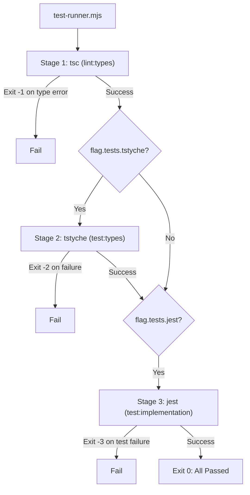

# Maintenance Guide: Diamond (R47-T018)

This document explains the internal file layout, architectural roles, and test execution workflow for the `diamond` practice exercise in the Exercism TypeScript track.

---

## 1. Exercise Overview

The Diamond exercise takes a letter (e.g. `'C'`) and returns a formatted multi-line string forming a diamond shape starting with `'A'` and widening to the given letter.

---

## 2. File Roles and Architecture

Every practice exercise in the TypeScript track adheres to a strict separation of concerns:

### Learner Solution (`diamond.ts`)
- **Role:** The starter stub provided to students.
- **Contract:** It defines the public function signature `export function makeDiamond(character: unknown): unknown`.
- **Constraint:** In the repository, this file must **never** contain the working solution. It throws an error (`'Remove this line and implement the function'`) so learners start with a fresh, unsolved stub.

### Reference Implementation (`.meta/proof.ci.ts`)
- **Role:** The complete, canonical working solution maintained by track contributors.
- **Contract:** Implements the algorithm to construct each row with appropriate outer and inner spaces, joining them with newlines.
- **Usage:** Used by CI and verification scripts (`check.py`) to confirm that all tests pass, the problem is solvable, and test runner configurations work as expected.

### Test Suite (`diamond.test.ts`)
- **Role:** The Jest-based test file specifying the exercise requirements.
- **Contract:** Contains canonical test cases (Letter A, Letter C, Letter E) comparing the output of `makeDiamond` to expected diamond shapes.
- **Progression:** When downloaded by students, subsequent tests are skipped (`xit`) to facilitate test-driven development (TDD). In CI, all tests are unskipped.

### Generated & Metadata Files

- **`.meta/config.json`:**
  - Declares the file mappings (`solution`, `test`, `example`).
  - Contains exercise metadata (blurb, authors, contributors).
  - Specifies track runner flags under `custom` (e.g., `"flag.tests.jest": true`, `"flag.tests.tstyche": false`).
  - Validated by `tools/course_checks/r47-t018.py` to ensure declared files exist and do not escape the exercise directory.

- **`.meta/tests.toml`:**
  - Auto-generated tracking file synced with Exercism's canonical problem-specifications repository.
  - Maps test cases to their canonical UUIDs and descriptions.
  - Can include manual comments under a `comment` key without being overwritten during `configlet sync`.

---

## 3. How the Test Runner Discovers and Executes Tests

The exercise `package.json` specifies:
```json
"scripts": {
  "test": "corepack yarn node test-runner.mjs"
}
```

When a user or CI runs `corepack yarn test`, `test-runner.mjs` executes through the following steps:

### 1. Metadata Discovery
`test-runner.mjs` searches for the configuration file in:
1. `./.meta/config.json`
2. `./.exercism/config.json`

If neither exists, it terminates immediately with an error. It then parses `config.json` to inspect track flags (such as `flag.tests.jest` and `flag.tests.tstyche`).

### 2. Multi-Stage Test Pipeline

The runner executes tests in three distinct stages:



1. **Stage 1 — Compilation (`tsc`):**
   - Command: `corepack yarn lint:types` (`tsc --noEmit -p .`)
   - Validates that the TypeScript code is free of syntax and type errors.
   - If compilation fails, the script exits with `-1`.

2. **Stage 2 — Type Tests (`tstyche`):**
   - Enabled only if `flag.tests.tstyche` is `true`.
   - Checks static type assertions when exercises test advanced type mechanics.
   - For `diamond`, `tstyche` is `false`, so this step is skipped.

3. **Stage 3 — Runtime Tests (`jest`):**
   - Command: `corepack yarn test:implementation` (`jest --no-cache --passWithNoTests`)
   - Executes `diamond.test.ts` against the solution.
   - When run in CI, setting `CI=true` disables interactive watch mode.
   - If tests fail, the script exits with `-3`.

---

## 4. Maintenance and Verification Commands

To check the metadata integrity:
```bash
python3 tools/course_checks/r47-t018.py
```

To run the automated test verification in an isolated temporary directory:
```bash
python3 work/R47-T018/check.py
```
